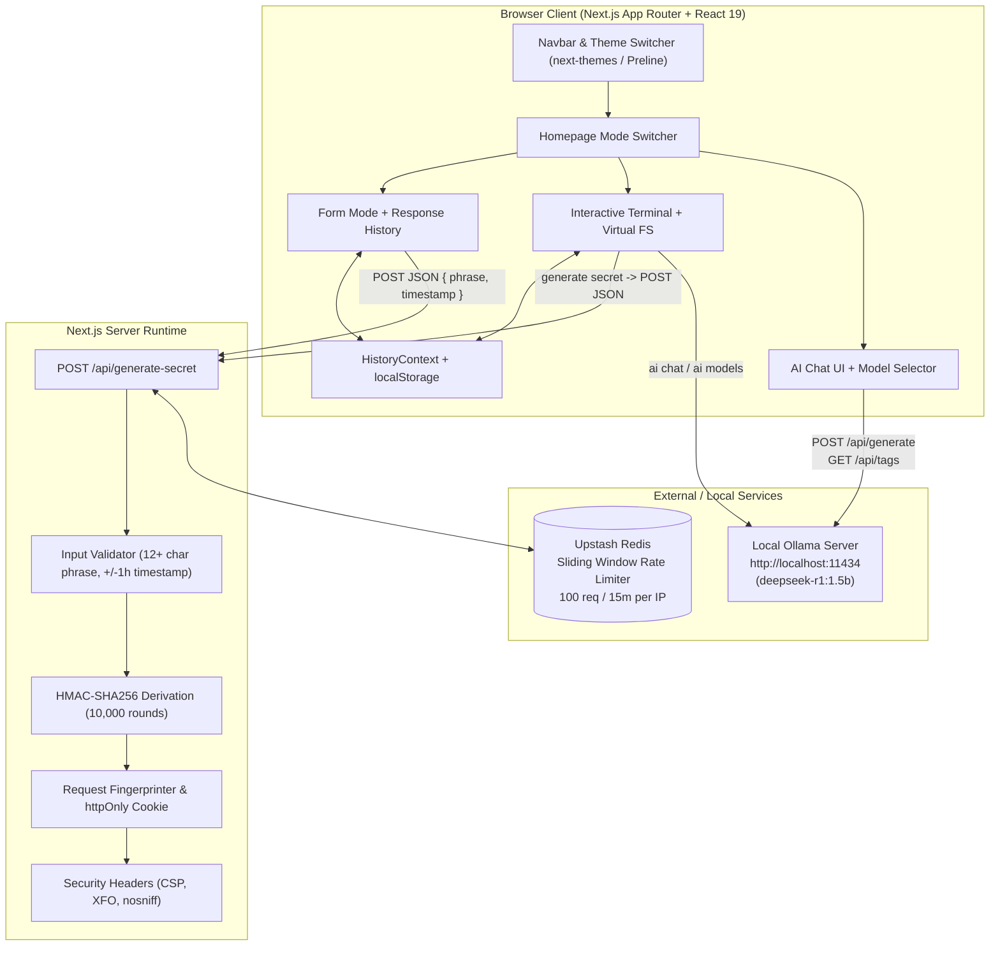

# Secret Key Generator

> **A multi-modal cryptographic secret derivation platform combining deterministic HMAC-SHA256 key generation, an interactive web terminal, and local Ollama AI assistance.**

[](./LICENSE)
[](https://nextjs.org/)
[](https://www.typescriptlang.org/)
[](https://tailwindcss.com/)
[](./docs/architecture/system-design.md)

---

## Overview

**Secret Key Generator** (`digitalterrene/secretmanager`) is a Next.js App Router application designed for generating deterministic, high-entropy 256-bit hex secrets from user-supplied passphrases and Unix timestamps. It pairs a rate-limited, header-hardened derivation API with three developer-focused interaction modes:

- **Form Mode**: Guided passphrase strength checks, one-click 13-digit Unix timestamp capture/insertion, and a side-by-side response history panel with copy and delete controls.
- **Interactive Terminal Mode**: Browser-based CLI supporting a simulated filesystem (`ls`, `cd`, `cat`, `mkdir`, `touch`, `rm`, `run`), math evaluation (`calc`), password-masked secret generation (`generate secret`), and interactive Ollama chat (`ai chat`, `ai models`).
- **AI Chat Mode**: Direct, privacy-preserving chat interface connected to a local [Ollama](https://ollama.com/) instance (defaulting to `deepseek-r1:1.5b`) so prompts never leave the developer's machine.

---

## System Architecture



> For deep-dive sequence diagrams, component hierarchies, and API contracts, see [`docs/architecture/system-design.md`](./docs/architecture/system-design.md).

---

## Quick Start (3 Commands)

### Prerequisites

- **Node.js** `>= 20.x` and **npm** `>= 10.x`
- An **[Upstash Redis](https://console.upstash.com/)** database (REST URL & Token) for API rate limiting
- *(Optional)* **[Ollama](https://ollama.com/)** running locally on port `11434` with `deepseek-r1:1.5b` pulled for AI Chat and Terminal AI commands

### 1. Clone & Install

```bash
git clone https://github.com/digitalterrene/secretmanager.git
cd secretmanager
npm install
```

### 2. Configure Environment

```bash
cp .env.example .env.local
# Edit .env.local with your SECRET, optional PEPPER, and Upstash Redis credentials
```

### 3. Start the Development Server

```bash
npm run dev
```

Open [http://localhost:3000](http://localhost:3000) in your browser.

*(Optional)* To enable local AI Chat with CORS allowed from `http://localhost:3000`:

```bash
ollama pull deepseek-r1:1.5b
OLLAMA_ORIGINS=* ollama serve
```

---

## Environment Variables

All required and optional environment variables are documented in [`.env.example`](./.env.example).

| Variable | Required | Scope | Description |
|---|---|---|---|
| `SECRET` | **Yes** | Server | High-entropy HMAC-SHA256 signing key for deterministic secret derivation and request fingerprinting (`openssl rand -hex 32`). |
| `PEPPER` | No | Server | Optional static pepper concatenated between `phrase` and `timestamp` before key derivation. Defaults to `""`. |
| `UPSTASH_REDIS_REST_URL` | **Yes** | Server | Upstash Redis REST endpoint used by `@upstash/ratelimit` sliding window limiter. |
| `UPSTASH_REDIS_REST_TOKEN` | **Yes** | Server | Upstash Redis REST authentication token. |

---

## Tech Stack

| Layer | Technology | Purpose |
|---|---|---|
| **Framework** | Next.js `15.0.3` (App Router) | Full-stack React rendering and `/api/generate-secret` route handler |
| **UI & Styling** | React `19 RC`, Tailwind CSS `3.4`, Preline UI `2.5` | Responsive multi-mode workspace, tabs, and dark/light theming (`next-themes`) |
| **Language** | TypeScript `5.x` (strict mode) | End-to-end static type safety across API contracts and UI state |
| **Cryptography** | Web Crypto API (`crypto.subtle`) | 10,000-iteration HMAC-SHA256 key derivation and request fingerprinting |
| **Rate Limiting** | Upstash Redis + `@upstash/ratelimit` | Serverless sliding-window rate limiting (`100` requests / `15m` per IP) |
| **Local AI** | Ollama REST API (`http://localhost:11434/api`) | Privacy-preserving local LLM inference (`deepseek-r1:1.5b` default) |
| **Icons** | `lucide-react`, `react-icons` | Terminal, chat, theme switcher, and action iconography |

---

## Documentation Architecture (4-Tier Standard)

This repository adheres to the **4-Tier Senior Documentation Architecture**:

| Tier | Document | Description |
|---|---|---|
| **Tier 1: Governance** | [CONTRIBUTING.md](./CONTRIBUTING.md) | Contribution workflow, quality gates, and PR lifecycle |
| **Tier 1: Governance** | [SECURITY.md](./SECURITY.md) | Responsible vulnerability disclosure policy and response SLAs |
| **Tier 1: Governance** | [docs/git-standards.md](./docs/git-standards.md) | Branch naming, Conventional Commits, and Chain-of-Thought rules |
| **Tier 1: Governance** | [LICENSE](./LICENSE) | MIT License terms |
| **Tier 2: Architecture** | [System Design & Topology](./docs/architecture/system-design.md) | Component diagrams, sequence flows, API contract, and terminal command matrix |
| **Tier 2: Architecture** | [Data Model & State](./docs/architecture/data-model.md) | TypeScript schemas, `localStorage` persistence, cookies, and Redis keys |
| **Tier 2: Architecture** | [Security & Threat Model](./docs/architecture/security-and-rbac.md) | HMAC derivation pipeline, validation rules, headers, and hardening roadmap |
| **Tier 3: Decisions** | [ADR Index](./docs/adr/README.md) | Immutable Architecture Decision Records (`ADR-001` through `ADR-004`) |
| **Tier 4: Operations** | [Deployment Verification](./docs/runbooks/deployment-verification.md) | Production smoke tests, curl checks, and rollback checklist |
| **Tier 4: Operations** | [Incident Response](./docs/runbooks/incident-response.md) | Triage flowchart, secret rotation, Redis outage, and Ollama troubleshooting |

---

## Available Scripts

| Command | Description |
|---|---|
| `npm run dev` | Starts Next.js development server with Turbopack (`http://localhost:3000`) |
| `npm run build` | Creates an optimized production build |
| `npm run start` | Serves the production build |
| `npm run lint` | Runs ESLint checks via Next.js |
| `npx tsc --noEmit` | Runs strict TypeScript static type checking |

---

## Security Notice

> **Warning**: This is security-critical software. Always audit environment secrets (`SECRET`, `PEPPER`), review [`docs/architecture/security-and-rbac.md`](./docs/architecture/security-and-rbac.md) before production deployment, and report vulnerabilities privately via [`SECURITY.md`](./SECURITY.md) (`security@vertueal.com`).
