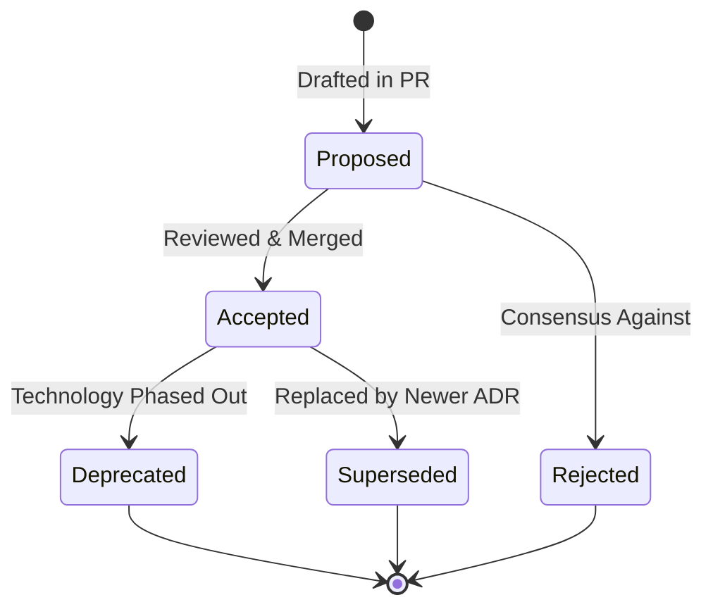

# Architecture Decision Records (ADRs)

This directory contains immutable records of architecturally significant decisions for **Secret Key Generator** (`digitalterrene/secretmanager`), following the Nygard / MADR standard.

## ADR Lifecycle

## ADR Index

| ADR | Title | Status | Date |
|---|---|---|---|
| [ADR-000](./ADR-000-template.md) | Architecture Decision Record Template | Template | 2026-11-22 |
| [ADR-001](./ADR-001-deterministic-hmac-secret-derivation.md) | Server-Side Deterministic HMAC-SHA256 Secret Derivation | Accepted | 2026-11-22 |
| [ADR-002](./ADR-002-upstash-redis-sliding-window-rate-limiting.md) | Upstash Redis Sliding-Window Rate Limiting | Accepted | 2026-11-22 |
| [ADR-003](./ADR-003-local-ollama-ai-integration.md) | Direct Local Ollama Integration for AI Security Assistance | Accepted | 2026-11-22 |
| [ADR-004](./ADR-004-multi-modal-interface-architecture.md) | Multi-Modal Workspace (Form, Interactive Terminal, AI Chat) | Accepted | 2026-11-22 |

## Creating a New ADR

1. Copy [`ADR-000-template.md`](./ADR-000-template.md) to `ADR-<next-number>-<kebab-case-title>.md`.
2. Fill out **Context**, **Decision**, **Consequences**, and **Alternatives Considered**.
3. Add the new record to the **ADR Index** table above in the same pull request.
4. Never rewrite an `Accepted` ADR's decision — supersede it with a new ADR instead.
