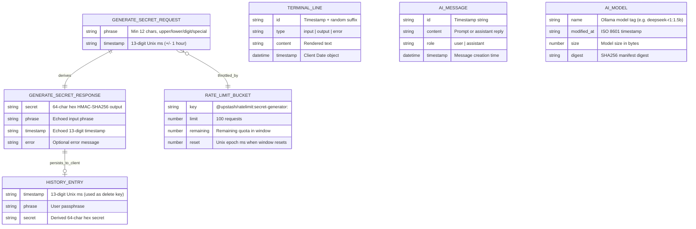

# Data Models, State Architecture & Persistence

*Status*: Living Architecture Specification  
*Last Updated*: 2026-11-22  
*Scope*: TypeScript domain models, browser `localStorage`, HTTP cookies, and Upstash Redis keys

---

## 1. Overview

**Secret Key Generator** is intentionally stateless with respect to persistent server-side databases for user secrets: **no passphrases or derived secrets are stored on the server**. Persistence is partitioned cleanly across three lightweight layers:

1. **Client Memory & `localStorage`**: Stores generated secret history (Form Mode), terminal line output, and terminal command history locally in the user's browser.
2. **HTTP Cookie (`secret-gen-fp`)**: Stores a server-signed HMAC-SHA256 request fingerprint for 24 hours.
3. **Upstash Redis**: Stores ephemeral sliding-window rate-limit buckets keyed by client IP address.

---

## 2. Domain Data Model Diagram



---

## 3. TypeScript Contracts

### 3.1 Server API Types (`src/lib/types.ts` & `src/lib/rate-limit.ts`)

| Type | Source File | Fields |
|---|---|---|
| `GenerateSecretRequest` | `src/lib/types.ts` | `phrase: string`, `timestamp: string` |
| `GenerateSecretResponse` | `src/lib/types.ts` | `secret?: string`, `phrase?: string`, `timestamp?: string`, `error?: string` |
| `RateLimitHeaders` | `src/lib/types.ts` | `"X-RateLimit-Limit"`, `"X-RateLimit-Remaining"`, `"X-RateLimit-Reset"` |
| `RateLimitResult` | `src/lib/rate-limit.ts` | `success: boolean`, `limit: number`, `remaining: number`, `reset: number` |

### 3.2 Client Domain Types (`src/types/index.tsx` & `src/types/ai.ts`)

| Type | Source File | Fields |
|---|---|---|
| `GenerateSecretOptions` | `src/types/index.tsx` | `phrase: string`, `timestamp: string` |
| `GenerateSecretResponse` | `src/types/index.tsx` | `secret: string` |
| `GenerateSecretError` | `src/types/index.tsx` | `error: string` |
| `HistoryEntry` | `src/types/index.tsx` | `timestamp: string`, `phrase: string`, `secret: string` |
| `AIMessage` | `src/types/ai.ts` | `id: string`, `content: string`, `role: "user" \| "assistant"`, `timestamp: Date` |
| `AIResponse` | `src/types/ai.ts` | `response: string`, `model: string`, `created_at: string`, `done: boolean` |
| `AIModel` | `src/types/ai.ts` | `name: string`, `modified_at: string`, `size: number`, `digest: string` |

---

## 4. Storage & Persistence Matrix

| Store | Key / Identifier | Format | Retention / Bound | Sensitivity | Owner Module |
|---|---|---|---|---|---|
| **React Context** | `HistoryContext.history` | `HistoryEntry[]` | In-memory (page session) | **High** (contains plaintext `phrase` & `secret`) | `src/context/HistoryContext.tsx` |
| **Browser `localStorage`** | `secret-history` | JSON array of `HistoryEntry` | Unbounded until manually cleared | **High** (plaintext JSON in browser storage) | `src/components/ui/form.tsx` |
| **Browser `localStorage`** | `terminal-history` | JSON array of `TerminalLine` | Capped at 100 entries (`lines.slice(0, 100)`) | **High** (may include terminal-generated secrets) | `src/components/Terminal.tsx` |
| **Browser `localStorage`** | `terminal-command-history` | JSON `string[]` | Capped at 100 commands (`maxSize = 100`) | **Low–Medium** (CLI commands) | `src/utils/CommandHistory.ts` |
| **HTTP Cookie** | `secret-gen-fp` | 64-char hex HMAC-SHA256 | `maxAge: 86400` (24 hours) | **Medium** (`httpOnly`, `sameSite: strict`, `secure` in prod) | `src/lib/security.ts` |
| **Upstash Redis** | `@upstash/ratelimit:secret-generator:<ip>` | Upstash sliding window sorted set/counters | 15-minute sliding window (`15 m`) | **Low** (IP rate-limit telemetry) | `src/lib/rate-limit.ts` |

> **Architectural Note on Sync**: Currently, `Form.tsx` writes to both `localStorage("secret-history")` and `HistoryContext.addToHistory()`, while `HistoryContext` initializes with an empty array `[]` and `removeFromHistory(timestamp)` only updates React state without removing the item from `localStorage`. Aligning `HistoryContext` hydration/deletion with `localStorage` (or moving to ephemeral encrypted session memory) is tracked in [`docs/architecture/security-and-rbac.md`](./security-and-rbac.md).

---

## 5. Virtual Filesystem Schema (Terminal Mode)

`TerminalCommands` (`src/utils/TerminalCommands.ts`) maintains an in-memory nested JavaScript object simulating a POSIX directory tree, reset on full page reload:

```text
/
├── home/
│   └── user/                  (default currentPath)
│       ├── .bashrc
│       ├── documents/
│       │   ├── readme.txt
│       │   └── projects/
│       │       └── terminal/
│       │           └── package.json
│       └── downloads/
├── usr/
│   ├── bin/
│   └── lib/
└── var/
    └── log/
```
