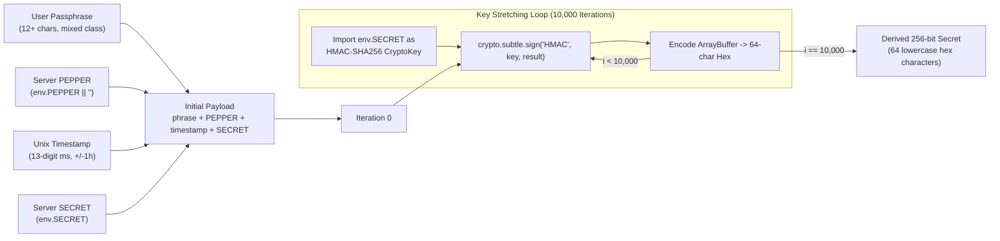

# Security Architecture, Cryptography & Threat Model

*Status*: Living Architecture Specification  
*Last Updated*: 2026-11-22  
*Security Contact*: `security@vertueal.com` (see [`SECURITY.md`](../../SECURITY.md))

---

## 1. Cryptographic Key Derivation Pipeline

Secret generation is executed server-side in [`src/lib/security.ts`](../../src/lib/security.ts) (`generateDeterministicSecret`) using the Web Crypto API (`crypto.subtle`):

### Properties
- **Determinism**: Identical `(phrase, timestamp, SECRET, PEPPER)` tuples always produce the exact same 64-character hex secret.
- **Server-Bound Entropy**: Because `env.SECRET` (and optional `env.PEPPER`) never leave the server runtime, an attacker with only the passphrase and timestamp cannot reproduce the secret offline.
- **Work Factor**: 10,000 sequential HMAC-SHA256 iterations raise brute-force cost while staying fast enough for serverless request latency.

---

## 2. Input Validation Rules

Enforced in `validateInputs(phrase, timestamp)` (`src/lib/security.ts`):

| Field | Rule | Rejection Status | Error Message |
|---|---|---|---|
| `phrase` | Must be `typeof === "string"` | `400` | `Invalid input types. Both phrase and timestamp must be strings.` |
| `phrase` | Minimum length `>= 12` characters | `400` | `Passphrase must be at least 12 characters long.` |
| `phrase` | At least one lowercase letter (`/[a-z]/`) | `400` | `Passphrase must contain at least one lowercase letter.` |
| `phrase` | At least one uppercase letter (`/[A-Z]/`) | `400` | `Passphrase must contain at least one uppercase letter.` |
| `phrase` | At least one digit (`/\d/`) | `400` | `Passphrase must contain at least one number.` |
| `phrase` | At least one special character (`/[^\w\s]/`) | `400` | `Passphrase must contain at least one special character.` |
| `timestamp` | Exact 13-digit numeric string (`/^\d{13}$/`) | `400` | `Invalid timestamp. It should be a 13-digit Unix timestamp.` |
| `timestamp` | Within `±1 hour` (`±3,600,000 ms`) of server `Date.now()` | `400` | `Timestamp is too far in the past or future. Please use a current timestamp.` |

> **Known UI/API Drift**: `src/components/ui/form.tsx` currently displays a visual strength check for `>= 8` characters (`hasMinLength = phrase.length >= 8`), whereas the API strictly enforces `>= 12` characters. Users submitting an 8–11 character passphrase receive an HTTP `400` error from the API.

---

## 3. Abuse Prevention & HTTP Defense-in-Depth

### 3.1 Distributed Rate Limiting (`src/lib/rate-limit.ts`)
- **Engine**: `@upstash/ratelimit` backed by `@upstash/redis` (`Redis.fromEnv()`).
- **Algorithm**: Sliding window — **100 requests per 15 minutes** per client IP.
- **Keying**: `req.headers.get("x-forwarded-for") ?? "127.0.0.1"`, prefixed with `@upstash/ratelimit:secret-generator`.
- **Telemetry**: `analytics: true`, returning `X-RateLimit-Limit`, `X-RateLimit-Remaining`, and `X-RateLimit-Reset` on both `200` and `429` responses.

### 3.2 Request Fingerprinting & Secure Cookie (`src/lib/security.ts`)
- Computes an HMAC-SHA256 digest of `user-agent | accept-language | x-forwarded-for` signed with `env.SECRET`.
- Stored in cookie `secret-gen-fp` with:
  - `httpOnly: true` (inaccessible to client-side JavaScript)
  - `secure: process.env.NODE_ENV === "production"` (HTTPS-only in production)
  - `sameSite: "strict"` (CSRF protection)
  - `path: "/"`
  - `maxAge: 86400` (24 hours)

### 3.3 HTTP Security Headers (`setSecurityHeaders()`)

| Header | Value | Mitigation |
|---|---|---|
| `Content-Security-Policy` | `default-src 'self'` | Restricts resource loading on API responses |
| `X-Content-Type-Options` | `nosniff` | Prevents MIME-type sniffing |
| `X-Frame-Options` | `DENY` | Prevents clickjacking / framing |
| `X-XSS-Protection` | `1; mode=block` | Legacy XSS filter activation |
| `Referrer-Policy` | `strict-origin-when-cross-origin` | Minimizes referrer leakage across origins |

---

## 4. Authentication & RBAC Posture

- **Current State**: Secret Key Generator operates as a **stateless, unauthenticated utility** with no user accounts, database-backed sessions, or Role-Based Access Control (RBAC). Access control relies on network perimeter, IP rate limiting, and server-side `SECRET` confidentiality.
- **Future Multi-User / Enterprise RBAC**: If user vaults or team key-sharing are introduced, an ADR must be authored before implementation defining authentication (e.g., OIDC/OAuth2 PKCE or short-lived JWTs) and role boundaries (`viewer`, `operator`, `admin`).

---

## 5. Threat Model & Hardening Roadmap

The following findings are documented transparently from the current codebase to guide production hardening:

| ID | Area | Current Behavior | Risk | Recommended Remediation |
|---|---|---|---|---|
| **SEC-01** | Client Storage | `Form.tsx` and `Terminal.tsx` persist plaintext `phrase` and `secret` values in `localStorage` (`secret-history`, `terminal-history`). | **High** — Any XSS or shared-device browser inspection exposes generated secrets. | Store history in-memory only, or encrypt with a session-derived Web Crypto AES-GCM key; add a "Clear Vault" button. |
| **SEC-02** | Terminal `run` Command | `TerminalCommands.runFile()` executes virtual file contents via `Function(content)()`. | **Medium** — Arbitrary client-side JS execution if untrusted content is introduced. | Replace `Function()` with a sandboxed interpreter or remove arbitrary JS execution in production builds. |
| **SEC-03** | Rate Limit IP Spoofing | `x-forwarded-for` is read raw without parsing the trusted proxy hop. | **Medium** — Direct clients (if not behind a trusted proxy like Vercel/Cloudflare) can spoof `X-Forwarded-For` to bypass rate limits. | Parse the leftmost/trusted proxy IP via platform-verified headers (e.g., `x-real-ip` / `cf-connecting-ip`). |
| **SEC-04** | Async Cookie Call | `route.ts` invokes `setSecureCookie(fingerprint)` without `await`. | **Low–Medium** — In Next.js 15 async `cookies()`, an unawaited call may race with response finalization. | `await setSecureCookie(fingerprint)` before returning `NextResponse.json(...)`. |
| **SEC-05** | Validation Parity | `Form.tsx` checks `phrase.length >= 8`; `security.ts` enforces `>= 12`. | **Low** — Confusing UX when submitting 8–11 char phrases. | Update `Form.tsx` `hasMinLength` to `>= 12` to match `validateInputs()`. |
| **SEC-06** | Ollama CORS | Local Ollama requires `OLLAMA_ORIGINS=*` when called directly from the browser. | **Low (Local Dev)** — Wildcard origin allows any visited webpage to query local Ollama. | Restrict to `OLLAMA_ORIGINS=http://localhost:3000` or proxy via a server-side Next.js Route Handler. |
