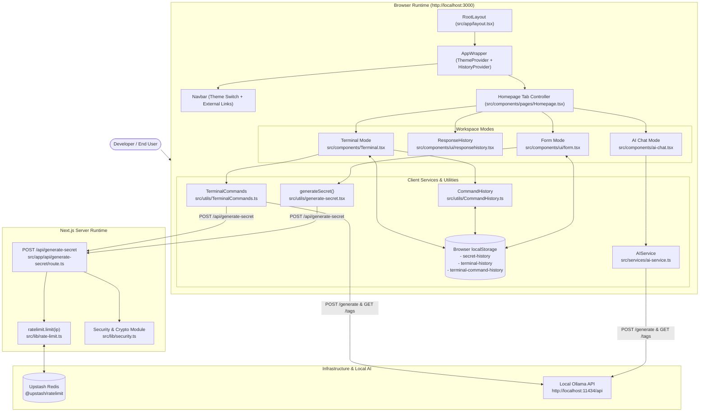
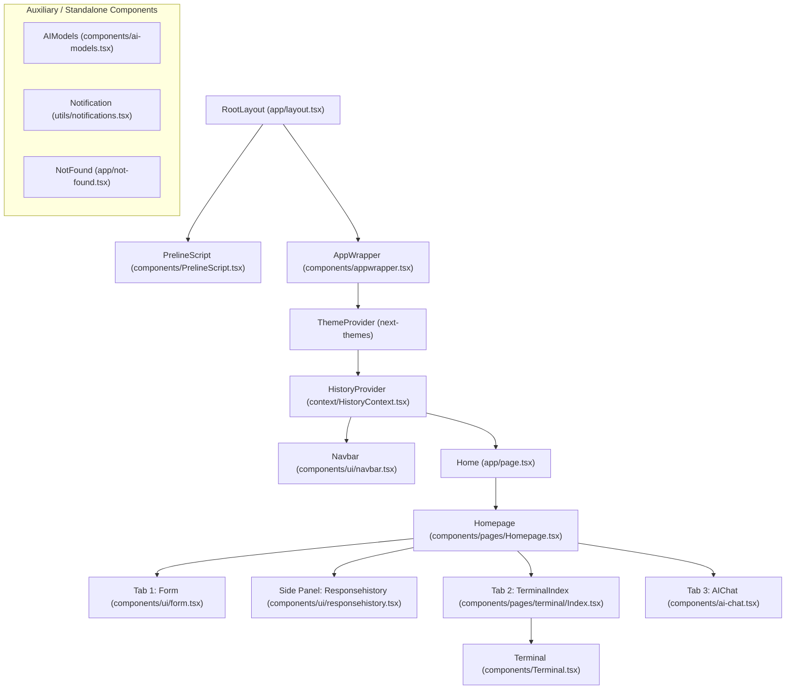
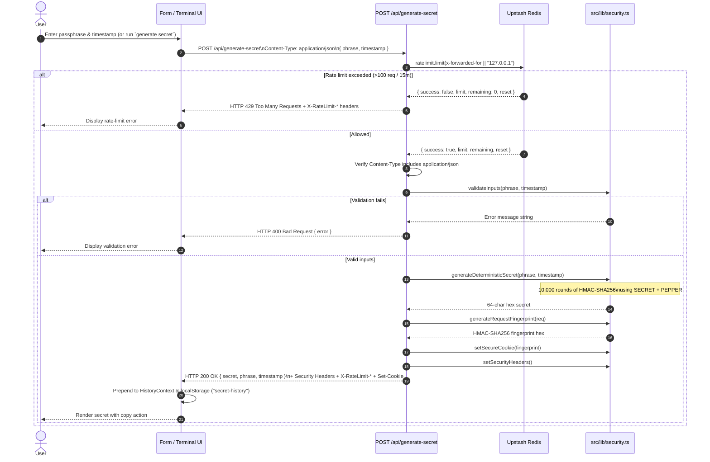
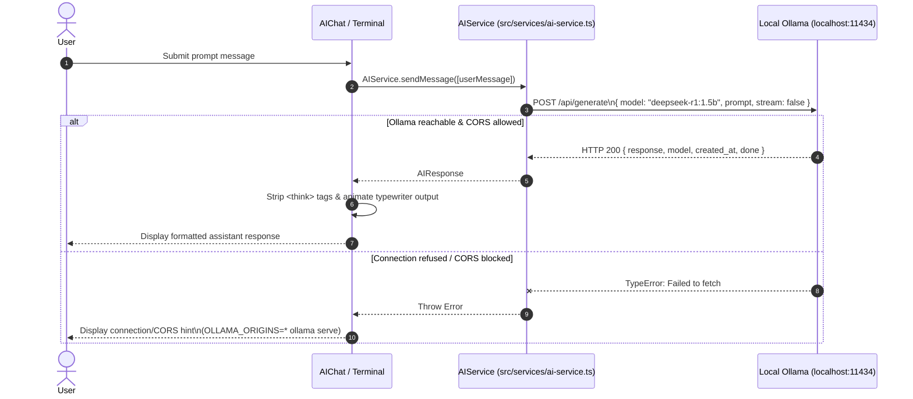

# System Design & Component Topology

*Status*: Living Architecture Specification  
*Last Updated*: 2026-11-22  
*Scope*: `digitalterrene/secretmanager` (Next.js 15 App Router + Upstash Redis + Local Ollama)

---

## 1. High-Level System Topology

**Secret Key Generator** is a full-stack Next.js App Router application composed of three runtime boundaries:

1. **Browser Client (React 19)**: Renders the three-tab workspace (Form, Interactive Terminal, AI Chat), manages transient session history via React Context (`HistoryContext`) and browser `localStorage`, and communicates directly with the Next.js API and local Ollama server.
2. **Next.js Server Runtime (`/api/generate-secret`)**: Enforces sliding-window rate limits, validates passphrase/timestamp inputs, executes 10,000-round HMAC-SHA256 deterministic key derivation using Web Crypto API, sets an `httpOnly` request fingerprint cookie, and attaches hardened HTTP security headers.
3. **External & Local Dependencies**:
   - **Upstash Redis** (Serverless REST): Stores sliding-window rate-limit counters per client IP.
   - **Local Ollama Daemon** (`http://localhost:11434`): Provides local LLM inference for both the AI Chat tab and the Terminal `ai chat` / `ai models` commands.



---

## 2. Frontend Component Hierarchy



---

## 3. Core Request Lifecycle Sequences

### 3.1 Secret Generation Flow (`POST /api/generate-secret`)

Both **Form Mode** (`generateSecret()` in `src/utils/generate-secret.tsx`) and **Terminal Mode** (`TerminalCommands.generateSecret()` in `src/utils/TerminalCommands.ts`) invoke the same backend API route.



### 3.2 Local AI Chat Flow (Browser -> Ollama)

AI queries are dispatched directly from the browser to the user's local Ollama runtime (`http://localhost:11434/api`). No prompts are routed through the Next.js server or third-party cloud APIs.



---

## 4. API Contract Specification

### `POST /api/generate-secret`

- **Source**: [`src/app/api/generate-secret/route.ts`](../../src/app/api/generate-secret/route.ts)
- **Content-Type**: `application/json` (strictly enforced)

#### Request Body

```json
{
  "phrase": "MyS3cure!Passphrase",
  "timestamp": "1732227957000"
}
```

#### Response Codes

| HTTP Status | Condition | Body Schema | Notable Headers |
|---|---|---|---|
| `200 OK` | Secret successfully derived | `{ "secret": "<64-hex>", "phrase": "<string>", "timestamp": "<13-digit>" }` | `X-RateLimit-*`, `Content-Security-Policy`, `X-Frame-Options`, `X-Content-Type-Options`, `Referrer-Policy`, `Set-Cookie: secret-gen-fp=...` |
| `400 Bad Request` | Missing `application/json` header or failed input validation | `{ "error": "<validation message>" }` | — |
| `429 Too Many Requests` | Sliding window limit exceeded (`100` req / `15m` per IP) | `{ "error": "Too many requests, please try again later." }` | `X-RateLimit-Limit`, `X-RateLimit-Remaining`, `X-RateLimit-Reset` |
| `500 Internal Server Error` | Missing `SECRET` env var, Redis failure, or unhandled exception | `{ "error": "Internal server error" }` | — |

---

## 5. Interactive Terminal Command Matrix

Implemented in [`src/utils/TerminalCommands.ts`](../../src/utils/TerminalCommands.ts) and hosted by [`src/components/Terminal.tsx`](../../src/components/Terminal.tsx):

| Category | Command | Description |
|---|---|---|
| **Secrets** | `generate secret` | Enters password-masked `phrase>` prompt, auto-generates 13-digit timestamp, and calls `POST /api/generate-secret` |
| **Local AI** | `ai chat` | Activates interactive Ollama chat mode (`You>` prompt); exit with `exit chat` |
| **Local AI** | `ai models` | Queries `http://localhost:11434/api/tags` to check available Ollama models |
| **Virtual FS** | `ls`, `cd`, `pwd`, `cat`, `mkdir`, `touch`, `rm` | Operates on an in-memory POSIX-like directory tree rooted at `/home/user` |
| **Execution** | `run [file]` | Evaluates string content of a virtual file as JavaScript |
| **Utilities** | `calc [expr]`, `echo [text]`, `date`, `whoami`, `uptime`, `uname`, `history`, `clear`, `help` | Built-in shell utilities and session inspection |

---

## 6. Synchronous vs. Asynchronous Boundaries

- **Synchronous UI Operations**: Tab switching (`Homepage`), passphrase strength checks (`Form`), virtual filesystem navigation (`TerminalCommands`), and clipboard copies (`Responsehistory`).
- **Asynchronous Network Operations**:
  - `POST /api/generate-secret` (client -> Next.js -> Upstash Redis -> Web Crypto 10,000-round loop).
  - `POST http://localhost:11434/api/generate` and `GET http://localhost:11434/api/tags` (client -> local Ollama).
- **No Background Workers / Queues**: All secret derivation and AI inference requests execute inline within their respective HTTP request/response lifecycles.
