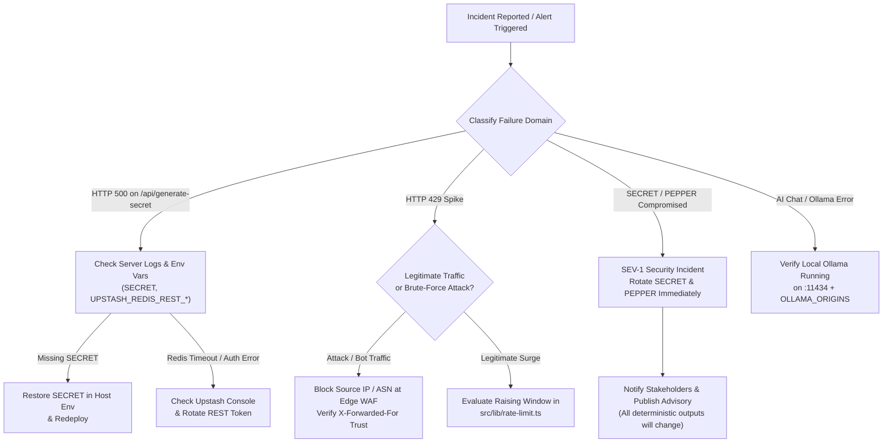

# Incident Response Runbook

*Status*: Active Operational Runbook  
*Last Updated*: 2026-11-22  
*Security Contact*: `security@vertueal.com`

This runbook defines triage workflows and remediation procedures for production incidents affecting **Secret Key Generator**.

---

## 1. Triage Flowchart



---

## 2. Severity Matrix & SLAs

| Severity | Examples | Initial Response | Resolution Target |
|---|---|---|---|
| **SEV-1 (Critical)** | `SECRET` or `PEPPER` leaked in VCS/logs; active RCE/XSS exploit | < 12 hours | 24–72 hours |
| **SEV-2 (High)** | `/api/generate-secret` returning 500s; Upstash Redis outage | < 24 hours | 48 hours |
| **SEV-3 (Medium)** | Elevated 429s from proxy misconfiguration; UI regression | < 48 hours | 7 business days |
| **SEV-4 (Low)** | Local Ollama CORS error; non-blocking UI glitch | < 72 hours | Next release |

---

## 3. Scenario Playbooks

### Scenario A: `SECRET` or `PEPPER` Leak (SEV-1)

1. **Contain**: Immediately generate a new 256-bit secret:
   ```bash
   openssl rand -hex 32
   ```
2. **Rotate**: Update `SECRET` (and `PEPPER` if compromised) in the production hosting environment and trigger a redeploy.
3. **Scrub VCS** (if committed to git): Rewrite git history using `git filter-repo` or BFG Repo-Cleaner, force-push protected branches, and invalidate any exposed tokens.
4. **Communicate**: Inform affected users that deterministic outputs derived with the rotated `SECRET` will differ from historical outputs and any secrets derived using the leaked key should be rotated in downstream systems.

### Scenario B: Upstash Redis Outage or Credential Error (SEV-2)

Symptoms: `POST /api/generate-secret` returns `500 Internal Server Error` with Redis fetch/auth errors in server logs.

1. Check [Upstash Status](https://status.upstash.com/) and verify database health in the Upstash Console.
2. Confirm `UPSTASH_REDIS_REST_URL` and `UPSTASH_REDIS_REST_TOKEN` match the active database credentials.
3. Test Redis connectivity directly:
   ```bash
   curl -s -H "Authorization: Bearer ${UPSTASH_REDIS_REST_TOKEN}" "${UPSTASH_REDIS_REST_URL}/ping"
   ```
   Expected: `{"result":"PONG"}`
4. If credentials were rotated, update environment variables and redeploy.

### Scenario C: Local Ollama Connection / CORS Failure (SEV-4)

Symptoms: AI Chat displays `AI Error: Failed to fetch` or Terminal `ai chat` reports Ollama unreachable.

1. Verify Ollama is running locally:
   ```bash
   curl -s http://localhost:11434/api/tags
   ```
2. Ensure `deepseek-r1:1.5b` (or selected model) is pulled:
   ```bash
   ollama list
   ollama pull deepseek-r1:1.5b
   ```
3. Restart Ollama with explicit CORS origin allowed:
   ```bash
   OLLAMA_ORIGINS=http://localhost:3000 ollama serve
   ```

---

## 4. Post-Incident Review

Within 48 hours of resolving any SEV-1 or SEV-2 incident:
1. Document root cause, timeline, and blast radius.
2. Add preventive tests, CI checks, or an ADR if architectural changes are required.
3. Update this runbook with any new diagnostic commands discovered during triage.
